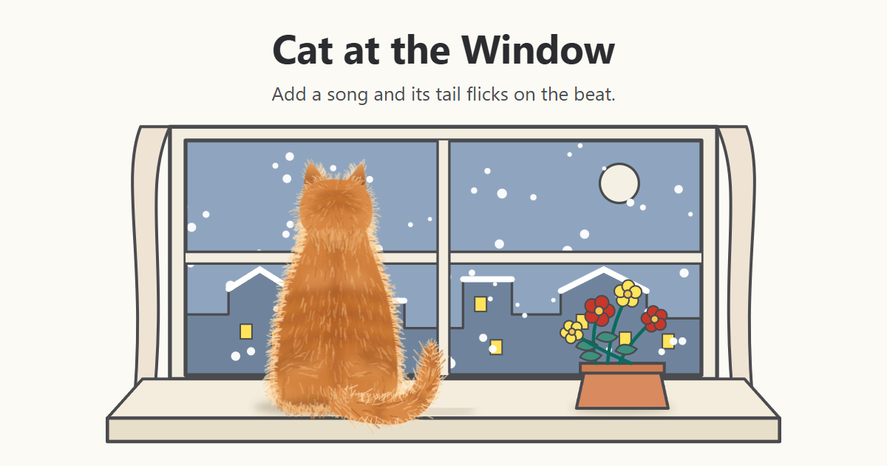

# Cat at the Window

A cat watching the snow, drawn in code. Add a song and its tail flicks on the beat.

**Play it:** <https://mike-byrne-ai.github.io/cat-at-the-window/>

**Keep it:** on that page, press "download the whole thing as one file". You get one 11 MB file with the songs inside. Open it in any browser: no install, and it works offline.

## What it does

- Two songs are built in. Tap one and the cat's tail flicks on the beat.
- Drop in your own song, or click the box to pick one: MP3, WAV, M4A, or anything else your browser plays. The page finds the tempo and lines the flick up with the drop.
- Click the cat to pet it.
- Pick a coat or any colour, with or without stripes, or press Surprise me.
- Save a picture, go full screen, and use the space bar to play and pause.

Your song stays on your device. The page reads it there and sends it nowhere.

## How it finds the beat

`beats.js` finds the tempo (60 to 200 BPM) from how the sound's energy rises and falls, then the first strong bass entry (the drop) and where each bar starts. It expects a steady tempo and four beats to a bar, so a song that changes speed or is in waltz time gets a less exact flick.

## Files

| File | What it is |
|---|---|
| `index.html`, `cat.js`, `beats.js`, `app.js`, `songs.js` | The page as it is served here. `cat.js` draws everything from one clock, so any moment of the animation can be drawn again exactly. |
| `songs/` | The two songs, `ॐ⸮↯ॐ⸮↯` and `ॐ⸮↯` |
| `cat-at-the-window.html` | The one-file copy, built from the files above by `python build.py`. `python build.py --check` says whether it is up to date. |
| `preview.png` | The picture a link preview shows |

## Adding your own songs to the list

Add an entry to `songs.js` with a `name`, a `src` and a `type`. Leave out `beat`, and the page measures the song the first time it plays; that needs the page served over http, as it is here, not opened from a file. Then run `python build.py` to refresh the one-file copy.

## License

Code: MIT-0 ([LICENSE](LICENSE)). Songs: CC0 1.0 ([songs/LICENSE](songs/LICENSE)), made with Suno. Copy, change and share anywhere, with no credit needed.

Made by Michael Byrne: <https://michaelbyrne.dev>
